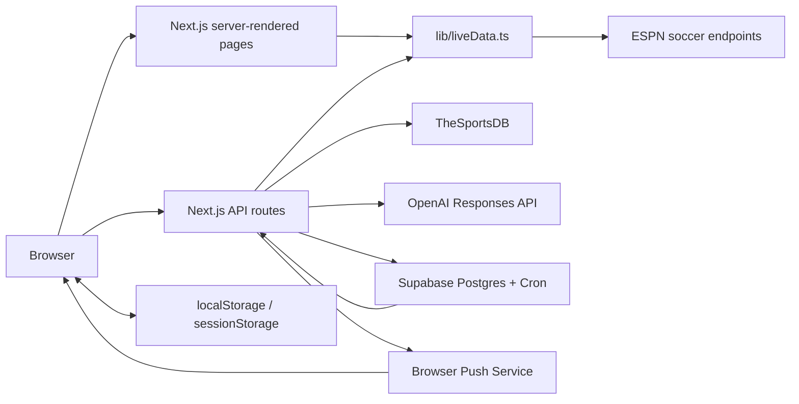
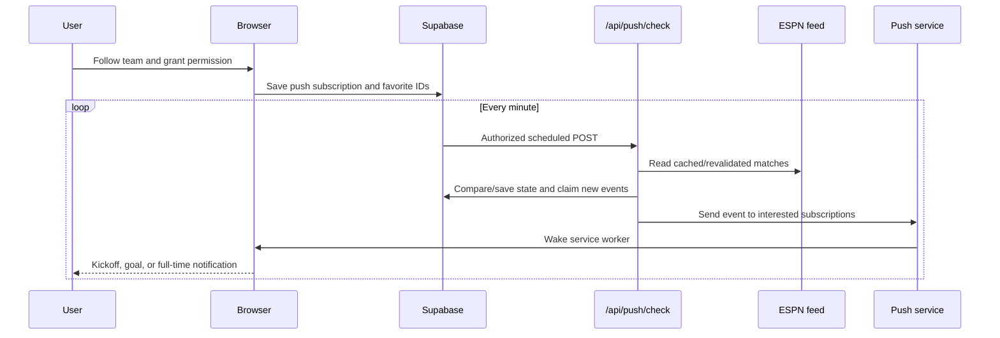

# Architecture and data flow

## System overview

The project is a Next.js App Router application. Most pages are dynamic React Server Components. Interactive features use small client components and browser storage.

Supabase stores authentication accounts, fantasy profiles, private leagues and memberships, private-room chat messages, push subscriptions, match-state comparison, event deduplication, and scheduled notification state.

The fantasy gameweek engine stores durable manager state, ordered benches, deadline snapshots, transfer ledgers, chip use, scoring breakdowns, and per-gameweek history in Supabase. A Supabase Cron job invokes the protected processor every minute. At a deadline, it snapshots each eligible saved squad and calculates net transfer deductions against the prior snapshot. When the official event is finalized and data-checked, it consumes official FPL live event totals, applies formation-safe substitutions, captaincy and chip multipliers, finalizes the score, and restores Free Hit squads. Official event totals aggregate double gameweeks and leave blank-gameweek players without fixture points.

Every processor run first executes an isolated legal-lineup simulation covering automatic substitutions, captain fallback, transfer deductions, all chips, doubles, and blanks. A failed simulation stops scoring before user records can be changed. Operational events persist for 30 days and power the admin health panel. Provider schema validation rejects incompatible FPL event responses. Season keys isolate manager state, histories, transfers, and chip use across annual FPL rollovers.

Sentry captures uncaught server, edge, and browser exceptions when `SENTRY_DSN` and `NEXT_PUBLIC_SENTRY_DSN` are configured. Supabase operational telemetry remains active without Sentry, so scheduled-run and provider health never depend on a third-party monitoring account.

The fantasy squad agent has three separate layers. The OpenAI Responses API translates natural language into bounded tool inputs. `lib/fantasyOptimizer.ts` is the application-owned decision engine: it scores the current player pool by position, reliability, attacking output, discipline, value, current-pick continuity, preferences, and strategy, then uses a bounded beam search to find the highest-scoring valid combination. `lib/fantasyAgentHarness.ts` validates tool inputs and final proposals against formation, budget, captain, duplicate-player, transfer, exclusion, lock, and maximum-three-per-team rules. The language model never chooses unchecked player IDs and cannot persist a squad. The browser shows the exact proposal and only sends it through the existing account-sync flow after explicit approval.

Private-room chat is accessed through authenticated Next.js API routes. Every read and write verifies private-league membership on the server. Messages are limited to 500 characters, escaped by React rendering, rate-limited, and fetched only while a user has the relevant chat open.

## Rendering model

All feature pages export `dynamic = 'force-dynamic'`. They render on the server and use the data functions in `lib/liveData.ts`.

`components/LiveRefresh.tsx` mounts in the root layout and calls `router.refresh()` every 15 seconds. This requests updated Server Component data without a full browser navigation.

Upstream `fetch` calls also use Next.js revalidation. A page refresh does not necessarily create a new provider request when a valid cached response is available.

## Football data

`lib/liveData.ts` is the integration boundary for football data. It:

- Requests ESPN scoreboard, standings, teams, rosters, and match summaries
- Applies an 8-second timeout
- Returns `null` on provider, timeout, parsing, or network failure
- Maps provider payloads into application-owned TypeScript types
- Formats fixture dates and times in `America/New_York`
- Loads the full tournament range from June 11 through July 19, 2026

### Cache policy

| Data | Revalidation |
| --- | ---: |
| Scoreboard and standings | 15 seconds |
| Match events, commentary, and box score | 10 seconds |
| Rosters/player totals | 60 seconds |
| Team profile | 300 seconds |
| TheSportsDB player image fallback | 86,400 seconds |

### Failure behavior

The integration deliberately degrades to empty arrays or `null` rather than throwing from most upstream requests. Pages then show an empty-state message or omit unavailable fields.

This keeps the site usable during partial provider outages, but it also means logs and monitoring are needed to distinguish “no data yet” from “provider failed.”

## Route-to-data mapping

| Page | Server data |
| --- | --- |
| `/` | Matches and standings |
| `/groups/[group]` | Matches and standings |
| `/matches/[matchId]` | Match list plus match summary |
| `/teams/[teamId]` | Team, standings, and matches |
| `/statistics` | All qualifying roster players plus matches |
| `/players/[playerId]` | All player stats, then player match summaries |
| `/favorites` | Standings; favorites are joined in the browser |
| `/compare` | Standings plus completed-match form |
| `/predictions` | Matches; saved forecasts are joined in the browser |

Player and statistics pages are the most provider-intensive because all team rosters are fetched in batches of eight.

## Client-side state

| Storage key | Storage | Content |
| --- | --- | --- |
| `world-cup-favorite-teams-v1` | `localStorage` | Favorite team IDs, names, and logos |
| `world-cup-ai-predictions-v1` | `localStorage` | Generated predictions and evaluated outcomes |
| `world-cup-live-snapshot-v1` | `localStorage` | Previous scores/statuses for notification comparison |
| `world-cup-ai-access-code` | `sessionStorage` | Shared AI endpoint access code |

No server synchronization occurs. Browser storage is the source of truth for these features.

## Notification flow

The first scheduled run establishes a baseline and does not produce event notifications. Unique event keys prevent duplicate deliveries across later runs.

## AI flow

AI calls are server-side:

1. The browser sends the shared access code in `x-ai-access-code`.
2. The route verifies the code with a timing-safe comparison.
3. The per-process rate limiter checks the client IP.
4. The server loads current football context.
5. The server calls the OpenAI Responses API with a strict JSON schema.
6. Probabilities are normalized to total 100%.
7. The browser saves the result locally.

`OPENAI_API_KEY` never needs to enter client-side JavaScript.

### Prediction desk

The prediction page loads upcoming fixtures only for the league selected in the URL, avoiding requests for every competition at once. A signed-in user can generate a structured forecast through `POST /api/predictions/leagues/:leagueId/:matchId`. The server resolves the fixture against the provider feed, loads the two table rows and recent relevant results, checks the shared persistent daily AI allowance, and sends that bounded context to the Responses API.

Each successful refresh is stored locally as a probability snapshot for that match. `ForecastProbabilityChart` plots only these real snapshots; it does not synthesize historical movement. The first forecast therefore displays a single observation and explains that another refresh is required before movement exists.

### Fantasy agent loop

1. A signed-in user sends a chat message, recent chat context, and the current squad to `POST /api/fantasy/agent`.
2. The route validates authentication, request size, squad shape, the short-window per-user/IP limit, and the persistent Supabase daily allowance.
3. The server loads the current fantasy player pool and calls the Responses API with `store: false` and a bounded set of function tools.
4. The model can inspect the squad, search players, invoke the optimizer with structured user constraints, propose a same-position transfer, set a captain, or propose a custom XI.
5. The optimizer evaluates current player data and the user's existing picks, while the separate harness validates every proposed write. The model cannot call the account persistence route directly.
6. A validated action is returned to the browser as a pending proposal. The user must select **Apply proposal** before normal fantasy account synchronization saves it.

The loop is capped at six tool rounds and keeps at most ten prior chat messages in a request to constrain latency and API spend. `fantasy_agent_usage` stores only a user ID, UTC date, and request count; it does not store chat content. The default allowance is 20 agent messages per signed-in user per UTC day.

## Component responsibilities

| Component | Responsibility |
| --- | --- |
| `SiteNav` | Responsive global navigation |
| `LiveRefresh` | 15-second Server Component refresh |
| `MatchDayCenter` | Fixture/result cards |
| `KnockoutBracket` | Horizontally scrollable bracket |
| `MatchLiveCenter` | Match stats, events, and commentary |
| `FavoriteButton` | Favorite toggle |
| `FavoritesDashboard` | Favorites list and permission UI |
| `NotificationEngine` | Foreground score polling and alerts |
| `PlayerImage` | Primary/fallback player-image resolution |
| `TeamComparisonTool` | Statistical and AI comparison UI |
| `PredictionTracker` | Generate/save one match forecast |
| `PredictionHistory` | Evaluate and display saved forecasts |

## Security boundaries

- External API keys are server-only environment variables.
- AI endpoints require a separate access code in production.
- IDs are resolved against live provider data rather than trusted directly.
- Team IDs must be numeric before the team endpoint is called.
- Player image queries are length-validated and URL-encoded.
- Security response headers are configured in `next.config.ts`.
- API routes use baseline per-IP rate limits.

See [Operations](OPERATIONS.md) for limitations and production hardening.
