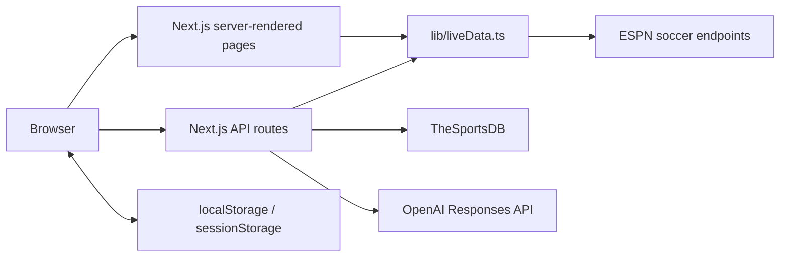
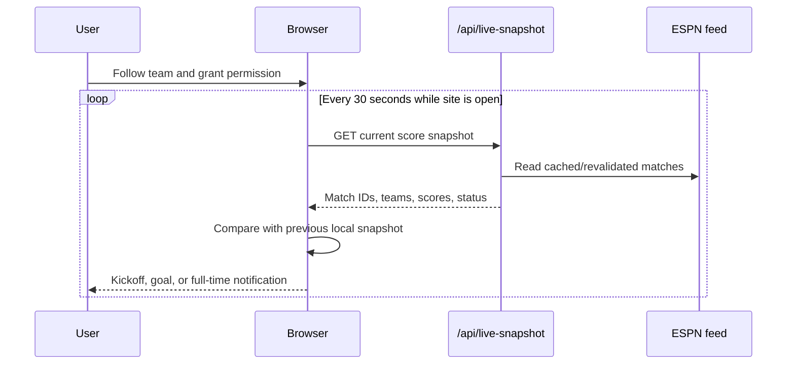

# Architecture and data flow

## System overview

The project is a Next.js App Router application. Most pages are dynamic React Server Components. Interactive features use small client components and browser storage.

There is no database, message queue, authentication provider, or background worker.

## Rendering model

All feature pages export `dynamic = 'force-dynamic'`. They render on the server and use the data functions in `lib/liveData.ts`.

`components/LiveRefresh.tsx` mounts in the root layout and calls `router.refresh()` every 15 seconds. This requests updated Server Component data without a full browser navigation.

Upstream `fetch` calls also use Next.js revalidation. A page refresh does not necessarily create a new provider request when a valid cached response is available.

## Football data

`lib/liveData.ts` is the integration boundary for football data. It:

- Requests ESPN scoreboard, standings, teams, rosters, and match summaries
- Applies an 8-second timeout
- Returns `null` on provider, timeout, parsing, or network failure
- Maps provider payloads into application-owned TypeScript types
- Formats fixture dates and times in `America/New_York`
- Loads the full tournament range from June 11 through July 19, 2026

### Cache policy

| Data | Revalidation |
| --- | ---: |
| Scoreboard and standings | 15 seconds |
| Match events, commentary, and box score | 10 seconds |
| Rosters/player totals | 60 seconds |
| Team profile | 300 seconds |
| TheSportsDB player image fallback | 86,400 seconds |

### Failure behavior

The integration deliberately degrades to empty arrays or `null` rather than throwing from most upstream requests. Pages then show an empty-state message or omit unavailable fields.

This keeps the site usable during partial provider outages, but it also means logs and monitoring are needed to distinguish “no data yet” from “provider failed.”

## Route-to-data mapping

| Page | Server data |
| --- | --- |
| `/` | Matches and standings |
| `/groups/[group]` | Matches and standings |
| `/matches/[matchId]` | Match list plus match summary |
| `/teams/[teamId]` | Team, standings, and matches |
| `/statistics` | All qualifying roster players plus matches |
| `/players/[playerId]` | All player stats, then player match summaries |
| `/favorites` | Standings; favorites are joined in the browser |
| `/compare` | Standings plus completed-match form |
| `/predictions` | Matches; saved forecasts are joined in the browser |

Player and statistics pages are the most provider-intensive because all team rosters are fetched in batches of eight.

## Client-side state

| Storage key | Storage | Content |
| --- | --- | --- |
| `world-cup-favorite-teams-v1` | `localStorage` | Favorite team IDs, names, and logos |
| `world-cup-ai-predictions-v1` | `localStorage` | Generated predictions and evaluated outcomes |
| `world-cup-live-snapshot-v1` | `localStorage` | Previous scores/statuses for notification comparison |
| `world-cup-ai-access-code` | `sessionStorage` | Shared AI endpoint access code |

No server synchronization occurs. Browser storage is the source of truth for these features.

## Notification flow

The first snapshot establishes a baseline and does not produce event notifications.

## AI flow

AI calls are server-side:

1. The browser sends the shared access code in `x-ai-access-code`.
2. The route verifies the code with a timing-safe comparison.
3. The per-process rate limiter checks the client IP.
4. The server loads current football context.
5. The server calls the OpenAI Responses API with a strict JSON schema.
6. Probabilities are normalized to total 100%.
7. The browser saves the result locally.

`OPENAI_API_KEY` never needs to enter client-side JavaScript.

## Component responsibilities

| Component | Responsibility |
| --- | --- |
| `SiteNav` | Responsive global navigation |
| `LiveRefresh` | 15-second Server Component refresh |
| `MatchDayCenter` | Fixture/result cards |
| `KnockoutBracket` | Horizontally scrollable bracket |
| `MatchLiveCenter` | Match stats, events, and commentary |
| `FavoriteButton` | Favorite toggle |
| `FavoritesDashboard` | Favorites list and permission UI |
| `NotificationEngine` | Foreground score polling and alerts |
| `PlayerImage` | Primary/fallback player-image resolution |
| `TeamComparisonTool` | Statistical and AI comparison UI |
| `PredictionTracker` | Generate/save one match forecast |
| `PredictionHistory` | Evaluate and display saved forecasts |

## Security boundaries

- External API keys are server-only environment variables.
- AI endpoints require a separate access code in production.
- IDs are resolved against live provider data rather than trusted directly.
- Team IDs must be numeric before the team endpoint is called.
- Player image queries are length-validated and URL-encoded.
- Security response headers are configured in `next.config.ts`.
- API routes use baseline per-IP rate limits.

See [Operations](OPERATIONS.md) for limitations and production hardening.
